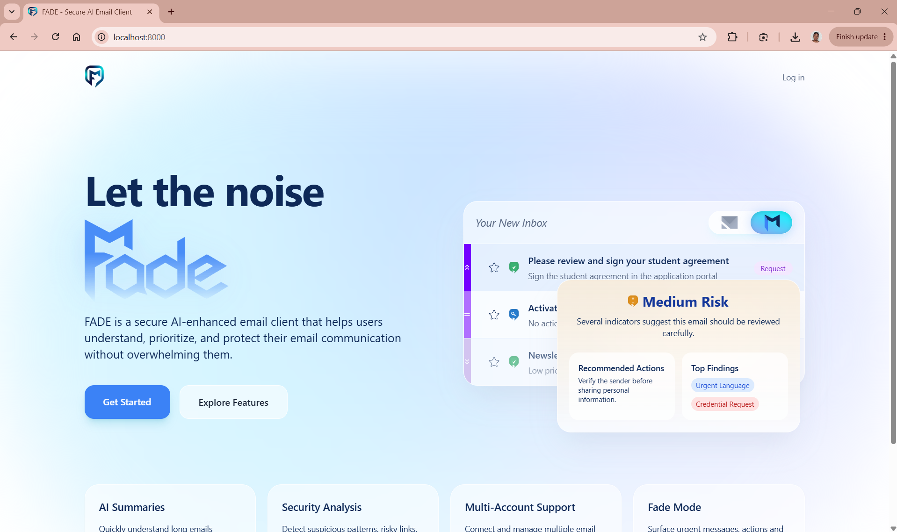

# FADE

FADE is a secure, AI-enhanced email client developed as part of a Bachelor's thesis at the West University of Timișoara.

The application combines traditional email management with AI-assisted productivity and integrated security analysis. Its goal is to help users process emails more efficiently while remaining informed about common email-based risks such as phishing, scams, suspicious links, sender inconsistencies, and potentially risky attachments.

<p align="center">
  
</p>

---

## Features

### Email Management

* Multi-account support
* Google and Microsoft OAuth authentication
* IMAP-based email synchronization
* SMTP email sending
* Inbox, Sent, Drafts, Spam, Outbox, and additional mailbox support
* Email composition
* Reply and Forward support
* Read and Unread management
* Starred emails
* Bulk email actions
* Account switching
* Sandboxed email content display

### AI Features

* AI-generated detailed summaries
* AI-generated short summaries
* Intent detection
* Secondary intent detection
* Tone detection
* Urgency classification
* Action extraction
* Recommended quick actions
* Classic Mode and Fade Mode interfaces
* Priority-based email presentation

### Security Features

* Email header analysis
* SPF, DKIM, DMARC, and ARC result inspection
* Reply-To and sender mismatch detection
* Suspicious link inspection
* HTTP and obfuscated link detection
* Urgency, financial, and credential-related text analysis
* Image-heavy or low-text email detection
* Risk classification
* Security findings and explanations
* Recommended security actions
* Administrative security dashboard

---

## Technology Stack

### Backend

* PHP 8.2 or later
* Laravel 12
* PostgreSQL 16
* Laravel Queues
* Laravel Jobs and Services
* IMAP
* SMTP

### Frontend

* Blade
* Livewire
* Alpine.js
* Tailwind CSS
* JavaScript
* AJAX
* Vite

### Key Packages

* Laravel Socialite
* Socialite Providers for Microsoft
* Webklex PHP-IMAP
* Symfony Mailer
* Mews HTML Purifier
* Blade Lucide Icons

### External Services

* Google OAuth
* Microsoft OAuth
* Google Gemini API
* Gmail IMAP and SMTP
* Microsoft authentication services

---

## Requirements

Before installing FADE, ensure the following software is installed:

* PHP 8.2 or later
* Composer
* Node.js and npm
* Docker Desktop, or a locally installed PostgreSQL server
* Git

The following PHP extensions must be enabled:

* `fileinfo`
* `zip`
* `pdo_pgsql`
* `pgsql`
* `openssl`
* `mbstring`
* `curl`

You can view the PHP extensions currently enabled for the command-line environment using:

```bash
php -m
```

You can identify the active PHP configuration file using:

```bash
php --ini
```

### Enabling PHP Extensions on Windows

Open the active `php.ini` file and ensure the required extensions are enabled.

For example:

```ini
extension=fileinfo
extension=zip
extension=pdo_pgsql
extension=pgsql
```

If the lines begin with a semicolon, remove it:

```ini
;extension=zip
```

becomes:

```ini
extension=zip
```

After modifying `php.ini`, close and reopen the terminal.

You can verify individual extensions in PowerShell using:

```powershell
php -m | findstr fileinfo
php -m | findstr zip
php -m | findstr pgsql
```

The PostgreSQL check should normally display:

```text
pdo_pgsql
pgsql
```

---

## Installation

### 1. Clone the Repository

```bash
git clone <repository-url>
cd <repository-directory>/laravel
```

If the repository has already been downloaded or copied manually, navigate directly to the `laravel` directory.

For example:

```powershell
cd "C:\path\to\FADE\laravel"
```

---

### 2. Start the Database

If PostgreSQL is provided through Docker, start the containers before running the Laravel setup:

```bash
docker compose up -d
```

Confirm that the containers are running:

```bash
docker compose ps
```

To view all active Docker containers:

```bash
docker ps
```

To stop the project containers later:

```bash
docker compose down
```

---

### 3. Create the Environment File

Create the Laravel environment file from the provided example.

On Linux or macOS:

```bash
cp .env.example .env
```

On Windows PowerShell:

```powershell
Copy-Item .env.example .env
```

The `composer run setup` command can also create `.env` automatically if it does not already exist.

---

### 4. Configure the Environment

Open `.env` and provide the required application credentials.

At minimum, configure:

* Application URL
* PostgreSQL database credentials
* Google OAuth credentials
* Microsoft OAuth credentials
* Google Gemini API key
* Mail provider settings
* Queue configuration

Example PostgreSQL configuration:

```env
DB_CONNECTION=pgsql
DB_HOST=127.0.0.1
DB_PORT=5432
DB_DATABASE=fade
DB_USERNAME=postgres
DB_PASSWORD=your_password
```

When PostgreSQL runs in Docker, the host and credentials must match the values defined in the Docker Compose configuration.

Do not commit real OAuth secrets, API keys, refresh tokens, passwords, or personal email credentials to the repository.

---

### 5. Run the Setup Command

From the `laravel` directory, run:

```bash
composer run setup
```

The setup command automatically:

* Installs Composer dependencies
* Creates the `.env` file if it does not exist
* Generates the Laravel application key
* Runs database migrations
* Installs Node.js dependencies
* Builds the frontend assets

If the setup process stops during the database migration step, verify that:

* PostgreSQL is running
* The `pdo_pgsql` and `pgsql` PHP extensions are enabled
* The database exists
* The `.env` database credentials are correct

After correcting the database configuration, rerun only the failed migration:

```bash
php artisan migrate --force
```

---

## Manual Installation

The project can also be installed manually instead of using `composer run setup`.

Install PHP dependencies:

```bash
composer install
```

Create the environment file if necessary:

```bash
php -r "file_exists('.env') || copy('.env.example', '.env');"
```

Generate the Laravel application key:

```bash
php artisan key:generate
```

Run the database migrations:

```bash
php artisan migrate
```

Install Node.js dependencies:

```bash
npm install
```

Build the frontend assets:

```bash
npm run build
```

Do not run `composer update` during normal installation.

The repository includes a `composer.lock` file so that the tested package versions can be installed consistently using:

```bash
composer install
```

---

## OAuth Configuration

FADE uses OAuth 2.0 to connect to supported email providers.

Before using the application, create OAuth applications for the providers you intend to use and add their credentials to `.env`.

### Google Configuration

For Google authentication and Gmail access:

* Create a project in Google Cloud Console
* Configure the OAuth consent screen
* Create OAuth client credentials
* Enable the required Gmail-related services
* Add the correct redirect URI
* Enable offline access
* Request the required email access scope

FADE requires access sufficient to:

* Authenticate the user
* Read and synchronize emails
* Send emails
* Maintain access through refresh tokens

The application currently uses the following Gmail scope for IMAP and SMTP access:

```text
https://mail.google.com/
```

### Microsoft Configuration

For Microsoft authentication:

* Register an application in Microsoft Entra ID
* Configure the redirect URI
* Add the required delegated permissions
* Create and configure the application credentials
* Allow offline access where required

Microsoft OAuth authentication is supported. However, Microsoft mailbox synchronization may be limited depending on IMAP availability, tenant configuration, provider restrictions, and the permissions granted to the application.

### Permission Requirements

When connecting an account for the first time, the user must grant all required permissions.

These permissions are used to:

* Read emails
* Synchronize mailboxes
* Send emails
* Retrieve account information
* Maintain authentication using refresh tokens

Without the required permissions, email synchronization and sending may not operate correctly.

> **Note:** It is recommended to test FADE using a dedicated test account rather than a personal or production mailbox.

---

## AI Configuration

FADE uses the Google Gemini API for email analysis.

Add the Gemini API credentials to `.env` using the configuration expected by the application.

The AI analysis pipeline can generate:

* Detailed summaries
* Short summaries
* Tone classifications
* Primary intent
* Secondary intents
* Urgency levels
* Suggested actions

Email content is sanitized before being submitted to the configured AI provider.

The generated output should be treated as assistive information rather than an authoritative decision.

---

## Running FADE

Ensure the PostgreSQL database or Docker containers are running:

```bash
docker compose up -d
```
For development, simply run:

```bash
composer run dev
```
This command starts:

Laravel development server
Queue listener
Vite development server

Alternatively, FADE can be run with the use of multiple terminals

### Terminal 1: Laravel Development Server

```bash
php artisan serve
```

The application will normally be available at:

```text
http://127.0.0.1:8000
```

### Terminal 2: Queue Worker

```bash
php artisan queue:work
```

The queue worker must remain active for background operations such as:

* Email synchronization
* Email security scanning
* AI email analysis
* Other queued jobs

### Terminal 3: Frontend Development Server

```bash
npm run dev
```

This starts the Vite development server and enables frontend asset updates during development.

For a production-style frontend build, use:

```bash
npm run build
```

---

## Useful Commands

### Clear Laravel Caches

```bash
php artisan optimize:clear
```

### Run Database Migrations

```bash
php artisan migrate
```

### Reset and Rebuild the Database

```bash
php artisan migrate:fresh
```

Use this command carefully because it deletes all existing database tables and data.

### Start the Queue Worker

```bash
php artisan queue:work
```

### Restart Queue Workers

```bash
php artisan queue:restart
```

### View Running Docker Containers

```bash
docker compose ps
```

### View Docker Logs

```bash
docker compose logs
```

To follow the logs continuously:

```bash
docker compose logs -f
```

### Stop Docker Containers

```bash
docker compose down
```

---

## Project Structure

```text
app/
├── Actions/
├── Http/
├── Jobs/
├── Livewire/
├── Models/
├── Providers/
├── Services/
│   ├── Ai/
│   ├── Auth/
│   ├── Mail/
│   └── Security/
└── helpers/

config/
database/
resources/
routes/
tests/
```

### Main Application Areas

#### `app/Jobs`

Contains queued jobs such as email synchronization, security scanning, and AI analysis.

#### `app/Livewire`

Contains interactive Livewire components used by the email interface and application workflows.

#### `app/Models`

Contains the Laravel Eloquent models used to represent users, accounts, emails, mailboxes, recipients, attachments, AI insights, security scans, and workspace data.

#### `app/Services/Ai`

Contains the AI provider integration and email analysis logic.

#### `app/Services/Auth`

Contains account authentication and provider-related logic.

#### `app/Services/Mail`

Contains email synchronization, message retrieval, sending, and mailbox-related services.

#### `app/Services/Security`

Contains the security analysis pipeline and individual email risk checks.

---

## Email Processing

FADE synchronizes email data through provider accounts and stores the required information in the local PostgreSQL database.

The synchronization process can retrieve:

* Message headers
* Sender and recipient information
* Subjects
* Message bodies
* Mailbox information
* Attachment metadata

To reduce initial synchronization time, the application may retrieve message headers before processing full bodies and attachments.

Email synchronization behavior depends on:

* The provider
* OAuth access
* IMAP support
* Mailbox availability
* Provider-specific restrictions

---

## Security Analysis

FADE applies a rule-based security analysis pipeline to synchronized emails.

The analysis can inspect:

* Authentication headers
* SPF results
* DKIM results
* DMARC results
* ARC results
* Sender and Reply-To differences
* Suspicious URLs
* Non-HTTPS links
* Obfuscated links
* Urgent or threatening language
* Credential requests
* Financial requests
* Image-heavy messages with limited text

The application assigns a risk level such as:

* Minimal
* Low
* Medium
* High

The detected reasons are stored and displayed to the user as security findings.

The security analysis is intended to support user awareness. It does not replace professional malware analysis, antivirus software, or independent verification of suspicious messages.

---

## Classic Mode and Fade Mode

FADE offers two email-list interfaces.

### Classic Mode

Classic Mode presents emails using familiar mailbox information such as:

* Sender
* Subject
* Snippet
* Attachment indicator
* Time
* Security badge

### Fade Mode

Fade Mode emphasizes AI-generated information and prioritization, including:

* Short AI summary
* Priority indicator
* Urgency
* Intent
* Suggested actions
* Security status

Users can switch between the two interfaces based on their preferred email-processing workflow.

---

## Supported Providers

| Provider  | Authentication | Email Synchronization |         Email Sending |
| --------- | -------------: | --------------------: | --------------------: |
| Gmail     |              ✅ |                     ✅ |                     ✅ |
| Microsoft |              ✅ |            ⚠️ Limited | ⚠️ Provider-dependent |

Microsoft OAuth authentication is supported.

Microsoft synchronization and sending capabilities may vary depending on Microsoft Graph permissions, IMAP availability, tenant configuration, and provider restrictions.

---

## Current Limitations

The current thesis implementation has the following limitations:

* Initial synchronization focuses on a limited number of recent messages
* Full mailbox synchronization is not implemented for every provider
* Microsoft OAuth authentication works, but Microsoft IMAP synchronization may be limited
* Attachment analysis is primarily metadata-based
* Full malware scanning is not implemented
* Search and advanced filtering are not fully implemented
* PGP encryption is not implemented
* AI-generated results may be incomplete or inaccurate
* The administrative workspace functionality is limited
* The thesis implementation primarily targets a single-user workspace model
* Background synchronization requires an active queue worker
* Provider behavior may differ depending on account settings and permissions

---

## Troubleshooting

### Composer Reports a Missing PHP Extension

Example:

```text
requires ext-fileinfo
```

or:

```text
requires ext-zip
```

Open the active `php.ini` file, enable the required extension, restart the terminal, and verify it using:

```bash
php -m
```

Do not use `--ignore-platform-req` as a permanent solution because the application genuinely depends on the required extensions.

---

### Laravel Reports `could not find driver`

Example:

```text
could not find driver
Connection: pgsql
```

Enable the PostgreSQL extensions in `php.ini`:

```ini
extension=pdo_pgsql
extension=pgsql
```

Restart the terminal and verify:

```powershell
php -m | findstr pgsql
```

---

### Laravel Cannot Connect to PostgreSQL

Verify that Docker or PostgreSQL is running:

```bash
docker compose ps
```

Check the `.env` values:

```env
DB_CONNECTION=pgsql
DB_HOST=127.0.0.1
DB_PORT=5432
DB_DATABASE=fade
DB_USERNAME=postgres
DB_PASSWORD=your_password
```

Then clear cached Laravel configuration:

```bash
php artisan optimize:clear
```

Retry the migration:

```bash
php artisan migrate
```

---

### Queued Tasks Are Not Running

Start the queue worker:

```bash
php artisan queue:work
```

If environment settings were changed, restart the worker:

```bash
php artisan queue:restart
```

---

### Frontend Styles or Scripts Are Missing

Install the frontend dependencies:

```bash
npm install
```

Then run:

```bash
npm run dev
```

or:

```bash
npm run build
```

---

### OAuth Redirect Errors

Verify that:

* The redirect URI in the provider console exactly matches the application configuration
* `APP_URL` is correct
* The OAuth client ID and secret are correct
* The provider credentials are stored in `.env`
* Laravel configuration caches have been cleared

```bash
php artisan optimize:clear
```

---

## Future Improvements

Potential future improvements include:

* Full mailbox synchronization
* Microsoft Graph-based synchronization
* Full-text encrypted search
* PGP encryption
* Advanced attachment scanning
* Antivirus and malware-scanning integration
* Additional AI providers
* Improved phishing detection
* Machine-learning-supported risk analysis
* Automatic email categorization
* Improved search and filtering
* Multi-user workspace support
* Enterprise workspace enhancements
* Expanded administrative controls
* Background synchronization scheduling
* Provider-independent mailbox handling
* More extensive automated testing

---

## Thesis

This project was developed as part of the Bachelor's thesis:

**FADE: A Secure AI-Enhanced Mail Client**

Faculty of Mathematics and Computer Science

West University of Timișoara

The project explores how email management, artificial intelligence, and security analysis can be integrated into a single user-facing application.

---

## Academic Use

FADE was created as an academic software project and proof of concept.

The system should not be considered a production-ready security product. Security classifications and AI results should be independently verified before users take sensitive actions.

---

## License

This project was developed for academic and research purposes.

Unless a separate license file is provided, the source code should not be assumed to permit unrestricted copying, redistribution, modification, or commercial use.
